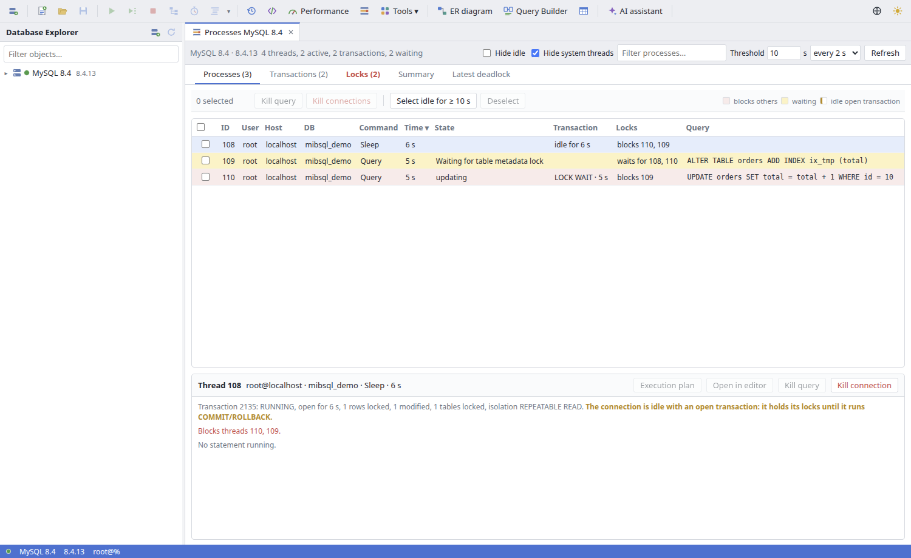
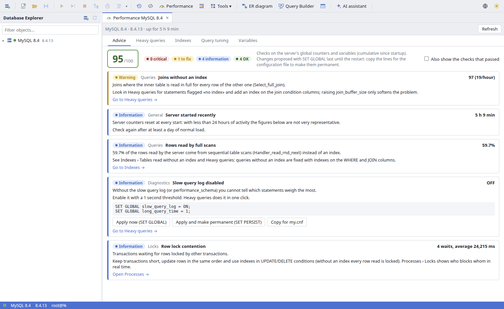
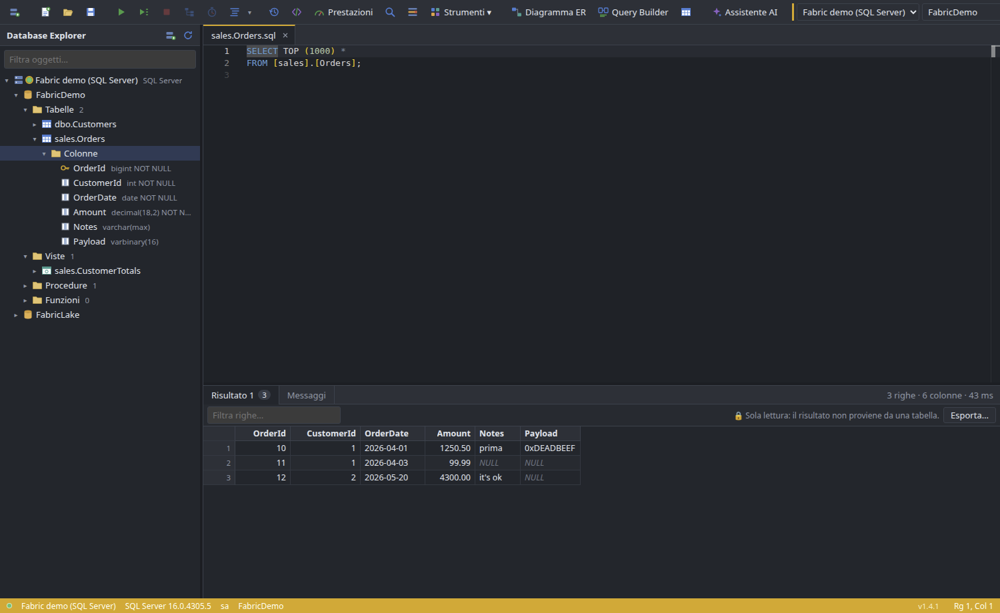
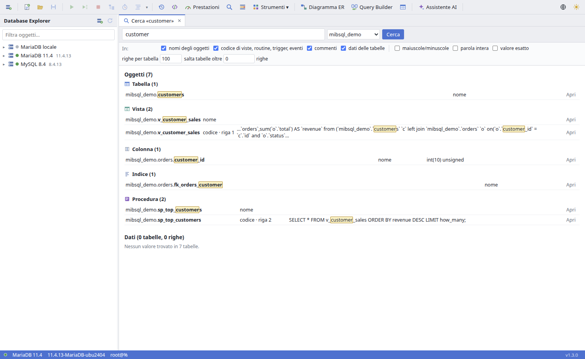
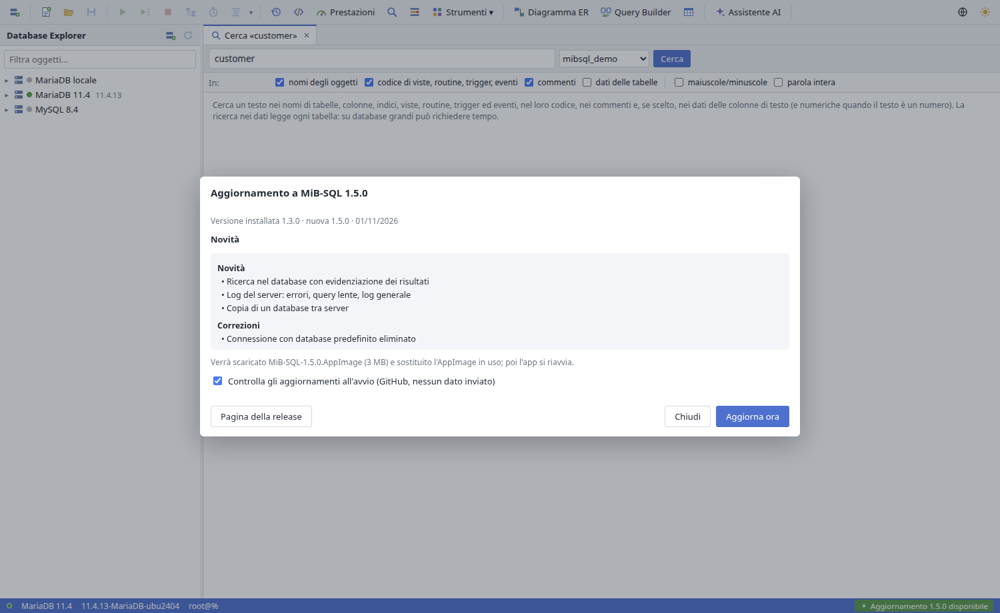

<p align="center"></p>

# MiB-SQL

[Italiano](README.md) · **English**

Educational IDE for **MariaDB and MySQL** (and, read only, **Microsoft Fabric Warehouse / SQL Server**) on Linux, inspired by [dbForge Studio](https://www.devart.com/dbforge/) (which runs on Linux only through CrossOver/Wine). Electron + React + Monaco, native `mariadb` driver. The interface is available in Italian and English (globe button at the end of the toolbar).





## What's new in 1.5

- **Microsoft Fabric Warehouse** (and SQL Server / Azure SQL), **read only**: new connection › *Database type* › *Microsoft Fabric Warehouse / SQL Server*, server = the warehouse's SQL connection string
  - **Microsoft Entra ID** sign-in in the browser (MFA included) or with a device code; the sign-in is kept (encrypted in the keyring) until the token expires; "Sign out" from the connection's context menu
  - Database Explorer with every warehouse and lakehouse of the workspace, tables and views as `schema.name`, columns, definitions; double click = first 1000 rows
  - T-SQL editor: batches separated by `GO`, variables, `PRINT` in the messages, Cancel, errors with their line; completion with `[names]`
  - results, export (CSV, Excel, JSON, SQL), history, snippets and the AI assistant (writing T-SQL)
  - the connection refuses INSERT, UPDATE, DELETE, CREATE, DROP, EXEC… (can be turned off in its properties)



## What's new in 1.4.1

- **Black window at startup** fixed: hardware acceleration is off by default (some video drivers left the window black); `--enable-gpu` turns it back on

## What's new in 1.4

- **Database search** (magnifier button, Ctrl+Shift+D, right click on a connection or database): a text in the names of tables, columns, indexes, views, routines, triggers and events, in their code, in comments and in data, with highlighted matches
- **Server logs**: error log (performance_schema.error_log, the log file or the systemd journal), slow query log and general log, with filters; turn logs on and off from the app
- **Copy database** to another database, on the same server or another connection
- **Built-in updates**: a notice when a new release is out, release notes and «Update now» (the AppImage is replaced and the app restarts, the .deb is installed with apt)
- Test data: composite foreign keys; Processes: one-click install of the METADATA_LOCK_INFO plugin on MariaDB





## What's new in 1.3

- **Performance** (toolbar, start page, right click on the connection): server configuration advice with a score, heaviest queries, duplicate/unused/missing indexes, query analysis and tuning, variables
- **Processes**: running connections and queries, open transactions, who blocks whom (row and metadata locks), summaries, latest deadlock; kill one or more connections
- **Test data**: fills tables with realistic data respecting types, foreign keys and unique values
- **Database documentation** as HTML or Markdown, with a relationship diagram
- **Italian and English interface**
- Object editor on MySQL: privileges on a routine are granted again automatically after DROP + CREATE

## Features

**Connections and explorer**
- Saved profiles with an environment color, passwords in the system keyring, TCP, Unix socket, SSL/TLS, **SSH tunnel**
- Database Explorer with tables, views, procedures, functions, triggers, events, columns, indexes and foreign keys; context menus for every object

**SQL editor**
- Monaco with schema completion (aliases too), one session per document, run script/selection/current statement, execution plan, cancel
- Errors underlined at the server's line, tabs restored at startup
- **Formatter** (Ctrl+Shift+F), **query history**, **snippets** (prefix + Tab)
- **Query profiler** (Ctrl+Shift+P): stages, session counters, actual plan, hints
- Right click › **Analyze and optimize query**

**Results and data editing**
- Virtualized grid with streaming, sorting, filters, copy, value viewer, binary columns
- Editable results for single tables with a primary key, SQL preview, one transaction with conflict checks
- Export to CSV, Excel, JSON and SQL INSERT

**Visual editors**
- **Table designer** (columns, indexes, foreign keys, CHECK constraints, partitions) generating minimal CREATE/ALTER
- **ER diagram** with visual relation drawing, PNG/SVG export
- **Query Builder**: drag tables and columns, joins from foreign keys, filters, grouping

**Compare, backup, import**
- Schema and data compare with a synchronization script (constant memory on large tables)
- Own SQL dump (also .sql.gz), streaming restore of any dump, CSV/Excel/JSON import wizard

**Objects and maintenance**
- Views, procedures, functions, triggers and events edited as documents and applied with CREATE OR REPLACE (or DROP + CREATE with automatic restore on MySQL); run routines with parameters
- Table maintenance: size and fragmentation, Analyze, Optimize, Check, Repair, Checksum

**Performance and tuning**
- **Advice**: more than 30 checks on server counters and variables (buffer pool and disk reads, redo log, temporary tables on disk, sorts, joins without an index, full scans, table and thread caches, query cache, connection limits, failed logins, slow log, performance_schema, locks and deadlocks, MyISAM tables, tables without a primary key or fragmented) with a score, an explanation and a proposed fix: **Apply now** (SET GLOBAL, SET PERSIST on MySQL 8) or **Copy for my.cnf**
- **Heavy queries** grouped by shape from performance_schema or from the slow query log on a table (enabled in one click without a restart)
- **Indexes**: duplicate and redundant, never used since startup (keeping those needed by foreign keys and UNIQUE constraints), tables without a primary key with the statement to add one, tables read without an index, low-selectivity indexes
- **Query tuning**: EXPLAIN without running the query, recognized problems (full scans, joins without an index, filesort, temporary tables, functions on indexed columns, leading-wildcard LIKE, implicit conversions, OR on different columns, NOT IN subqueries, large OFFSETs, SELECT *, ORDER BY RAND()) and **suggested indexes** created in one click
- **Variables** that matter most for performance, with explanations, editable

**Processes and transactions**
- Auto-refreshed list, sortable and filterable, multi-select to kill queries or connections, "select idle for ≥ N s"
- Colors for blockers, waiting threads and idle connections holding an open transaction
- Thread details: query, transaction, who waits and who blocks, **plan of the running statement**
- **Locks**: every blocking thread with all the threads it holds up, row and metadata locks, "Kill the blocker"; summaries by user, host, database, command or state; **latest deadlock** split by transaction

**Test data**
- Generators proposed from column names and types (names, emails matching the name, phones, cities, addresses, companies, URLs, IPs, UUIDs, words, sentences, numbers, dates, ENUM values, patterns, JSON, binaries, sequences, SQL expressions), Italian or English data, % of NULLs
- Parents inserted before children, foreign keys filled with existing values, unique columns and composite keys without duplicates; same seed, same data; script or direct insert in batches

**Database documentation**
- Single-page HTML (contents, summary, relationship diagram, light/dark and print styles) or Markdown, with columns, keys, indexes, foreign keys in both directions, CHECK constraints, triggers, views, routines and events

**Users, monitor, AI assistant, themes**
- Users and privileges editor, live session monitor with charts
- AI assistant (Claude) beside the SQL editor: SQL from plain language, explain, fix, optimize; nothing runs without you
- Light, dark or system theme

## Installation

From the [releases](https://github.com/mbulloni/MiB-SQL/releases):

```bash
sudo apt install ./mib-sql_x.y.z_amd64.deb    # Debian/Ubuntu
chmod +x MiB-SQL-*.AppImage && ./MiB-SQL-*.AppImage   # any distribution (Ubuntu 24.04 needs libfuse2t64)
```

Since 1.4.1 hardware acceleration is off: with some GPU drivers (virtual machines, nouveau, older Intel) the window stayed black. To turn it back on: `--enable-gpu` (or `MIBSQL_ENABLE_GPU=1`). With 1.4.0, `--disable-gpu` avoids the black window.

## Development

```bash
npm install
npm run dev        # Vite (port 5174) + Electron
npm test
npm run typecheck
npm run dist       # AppImage and .deb in release/
node scripts/i18n-keys.mjs   # texts missing from locales/en.json
```

UI texts are written in Italian inside `t('…')` calls; `locales/en.json` maps each text to English (missing ones fall back to Italian, and a test fails).

Test database: `scripts/demo.sql` creates `mibsql_demo` and the `mibsql`/`mibsql` user limited to it.

## Known limits

See the Italian [README](README.md#limiti-noti). In short: log files of remote servers are readable only through log tables or the FILE privilege; searching data reads every table; grid edits use their own connection; DDL is not transactional; performance_schema (or the slow log / userstat) is needed for heavy queries and unused indexes; index suggestions are heuristic; without the PROCESS privilege only your own connections are visible; the AppImage must live in a writable folder for self-update; server error messages follow the server's lc_messages. Microsoft Fabric / SQL Server connections offer explorer, editor, results, export, history, snippets and the assistant only (no grid editing, plan, profile or the MariaDB tools); DECIMAL values past 15 significant digits lose precision; tested against SQL Server 2022 in Docker and with the real Microsoft sign-in start, not yet on a real Fabric warehouse.

## License

MIT
