<p align="center"></p>

# MiB-SQL

IDE educativo per **MariaDB e MySQL** su Linux, ispirato a [dbForge Studio](https://www.devart.com/dbforge/) (che su Linux gira solo tramite CrossOver/Wine). Electron + React + Monaco, driver nativo `mariadb`.

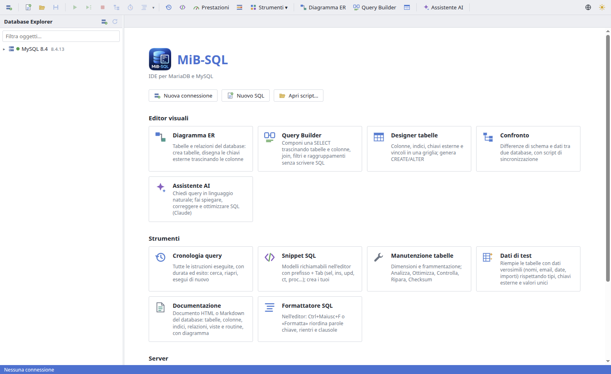

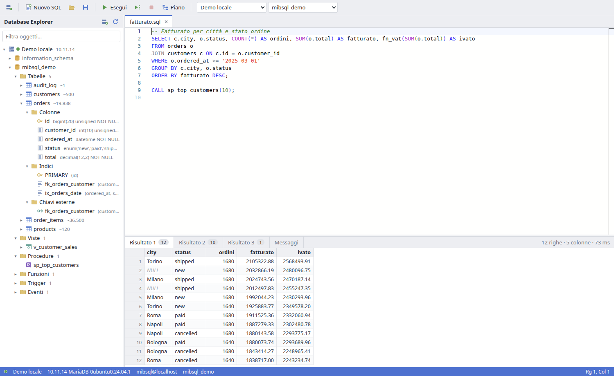

## Funzioni (v1.1)

**Connessioni**
- Profili salvati con colore d'ambiente (sviluppo/test/produzione: tinge scheda e barra di stato)
- Password nel portachiavi di sistema (Electron `safeStorage`); senza portachiavi vengono chieste a ogni sessione
- TCP, socket Unix, SSL/TLS (con verifica del certificato e CA), **tunnel SSH** (password, chiave privata, ssh-agent)
- Prova connessione; richiesta della password quando manca o è sbagliata

**Database Explorer**
- Database › Tabelle, Viste, Procedure, Funzioni, Trigger, Eventi; per tabella Colonne, Indici, Chiavi esterne
- Caricamento lazy da `information_schema`, filtro, conteggio righe stimato
- Menu contestuale: seleziona prime 1000 righe, conta righe, mostra DDL, genera CALL, copia/inserisci nome
- Trascina un oggetto nell'editor per inserirne il nome qualificato

**Editor SQL**
- Monaco con evidenziazione MySQL, una sessione dedicata per documento (USE, variabili, transazioni e tabelle temporanee restano per scheda)
- Autocompletamento sullo schema: tabelle, viste, routine, database, colonne delle tabelle referenziate e degli **alias** (`o.` → colonne di `orders`)
- Esegui script o selezione (F5), istruzione sotto il cursore (Ctrl+Invio), **piano di esecuzione** (Ctrl+E), interrompi (Maiusc+F5, `KILL QUERY`)
- Splitter compatibile con il client `mariadb`: stringhe, commenti, `DELIMITER` per procedure e trigger
- Errori sottolineati nell'editor alla riga indicata dal server; warning anche per le SELECT
- Schede ripristinate al riavvio, apri/salva `.sql`, `mib-sql script.sql` da terminale

**Risultati**
- Griglia virtualizzata: le SELECT arrivano in streaming, fino a 50.000 righe in memoria con il totale esatto anche oltre; più resultset per script e per `CALL`
- Ordinamento, ridimensionamento colonne, selezione a celle, copia TSV (Ctrl+C, con intestazioni Ctrl+Maiusc+C)
- Visualizzatore valore (doppio clic/Invio) con JSON formattato; BLOB in esadecimale, modificabili e caricabili/salvabili da file; NULL distinti

**Modifica dati**
- Risultati da una sola tabella con chiave primaria (o UNIQUE NOT NULL) modificabili in griglia: F2, Invio, doppio clic o digitazione diretta; Ctrl+Maiusc+N imposta NULL
- Aggiungi righe (colonne non toccate = DEFAULT), Canc elimina/ripristina le righe selezionate
- Modifiche evidenziate, **anteprima SQL**, applicazione in un'unica transazione con controllo dei conflitti (riga cambiata da un altro utente → rollback completo)
- Dopo l'applicazione le righe vengono rilette: si vedono DEFAULT, AUTO_INCREMENT, trigger e `ON UPDATE CURRENT_TIMESTAMP`
- Il motivo della sola lettura è sempre indicato (join, espressioni, chiave primaria mancante)

**Designer tabelle**
- «Nuova tabella…» e «Modifica tabella…» dall'Explorer: documento a schede Colonne, Indici, Chiavi esterne, Script
- Colonne con tipo, PK, NOT NULL, AUTO_INCREMENT, predefinito (espressione SQL), commento, collation, ON UPDATE, CHECK di colonna (json_valid delle colonne JSON preservato), colonne generate VIRTUAL/STORED; riordino con ↑ ↓
- Vincoli CHECK di tabella; indici con colonne DESC
- Partizioni RANGE/LIST (anche COLUMNS) con confini e commenti, HASH/KEY con numero di partizioni; ALTER minimi (ADD/DROP/REORGANIZE PARTITION, ripartizionamento) con avviso quando si perdono o ridistribuiscono righe
- Indici PRIMARY/UNIQUE/INDEX/FULLTEXT/SPATIAL con colonne ordinate e prefissi; chiavi esterne verso qualsiasi database con ON DELETE/ON UPDATE (le colonne della chiave primaria riferita si compilano da sole)
- Engine, collation (anche CONVERT TO), commento e rinomina della tabella
- Script generato per differenza: `CREATE TABLE` o `ALTER TABLE` minimo (rinominare una colonna non ricrea indici e FK), posizioni FIRST/AFTER, FK modificate eliminate e ricreate; validazione prima dell'esecuzione e conferma se si eliminano colonne
- Svuota (TRUNCATE) ed elimina tabella dall'Explorer, con conferma
- Verificato su MariaDB 10.11, MariaDB 11.4 e MySQL 8.4

**Diagramma ER (editor visuale)**
- Pulsante «Diagramma ER» nella toolbar o nella pagina iniziale (sul database selezionato nell'Explorer, altrimenti viene chiesto quale), oppure tasto destro sul database: disposizione automatica a livelli, notazione a zampa di gallina, relazioni opzionali tratteggiate
- Pan, zoom con la rotella, trascinamento delle tabelle (disposizione salvata), ricerca, modalità «Solo chiavi», tabelle nascoste
- Modifica visuale: «+ Tabella», «🔗 Relazione» trascinando da una colonna alla colonna riferita (controllo dei tipi, regole ON DELETE/UPDATE, anteprima SQL), elimina relazione (selezione + Canc), modifica ed elimina tabelle
- Esporta PNG e SVG

**Query Builder visuale**
- Pulsante «Query Builder» nella toolbar o nella pagina iniziale, oppure tasto destro sul database: tabelle trascinate dall'Explorer o scelte dalla lista
- Join automatici dalle chiavi esterne o disegnati trascinando una colonna su un'altra; clic sul join per INNER/LEFT/RIGHT o per eliminarlo
- Colonne spuntate, alias, aggregati con GROUP BY automatico, ordinamento, filtri WHERE/HAVING (IN, BETWEEN, LIKE, IS NULL…), DISTINCT, LIMIT
- SQL in tempo reale, esecuzione nel documento (F5), apertura nell'editor SQL

**Confronto schema e dati**
- Tasto destro sul database › «Confronta con…»: origine e destinazione su qualsiasi connessione/database (⇄ per invertirle)
- Schema: tabelle (colonne, indici, chiavi esterne, opzioni), viste, funzioni, procedure, trigger, eventi; stato Uguale/Diverso/Solo in origine/Solo in destinazione, diff riga per riga, istruzioni per oggetto
- Script di sincronizzazione minimo (ALTER per differenza, CREATE, DROP solo se scelti), apribile nell'editor o eseguito sulla destinazione dopo conferma
- Dati: per ogni tabella con la stessa chiave primaria, a blocchi per chiave con memoria costante (2 milioni di righe in pochi secondi), righe uguali/diverse/solo in origine/solo in destinazione, dettaglio con le celle diverse evidenziate, script INSERT/UPDATE/DELETE eseguito in un'unica transazione (binari compresi)

**Backup, ripristino, import**
- «Backup…» sul database: dump SQL proprio (non serve mariadb-dump), in streaming, anche compresso .sql.gz: struttura, dati, viste (in ordine di dipendenza), funzioni, procedure, trigger (dopo i dati), eventi; UTC per i TIMESTAMP, DEFINER rimovibile, scelta delle tabelle
- «Ripristina / esegui file SQL…»: file di qualsiasi dimensione letti a flusso (anche .gz e dump di mariadb-dump/mysqldump, con DELIMITER e commenti /*!…*/), byte per byte (i BLOB non vengono alterati), avanzamento, continua dopo gli errori con elenco
- «Importa dati…»: CSV (separatore rilevato, virgolette, UTF-8/Latin-1), Excel .xlsx (scelta del foglio), JSON/NDJSON; anteprima con tipi dedotti, virgola decimale, date gg/mm/aaaa, valori NULL; nuova tabella (con id facoltativo) o esistente con mappatura delle colonne, INSERT/IGNORE/REPLACE, svuota prima; tutto in un'unica transazione

**Profiler, monitor, utenti**
- **Profila** (Ctrl+Maiusc+P) l'istruzione sotto il cursore: tempo, fasi di esecuzione (SHOW PROFILE), contatori di sessione con spiegazione, piano reale (ANALYZE FORMAT=JSON su MariaDB, EXPLAIN ANALYZE su MySQL) con righe stimate/reali e tempi per tabella, consigli (join senza indice, scansioni complete, tabelle temporanee su disco, statistiche vecchie)
- **Monitor sessioni** (tasto destro sulla connessione): processi in tempo reale con durata, stato e query, termina query o connessione; indicatori e grafici di query/s, thread, connessioni, scritture, rete, hit ratio del buffer pool, query lente; aggiornamento 1-10 s, pausa
- **Utenti e privilegi**: account, nuova password, crea/elimina, privilegi per livello (globali, database, tabella, routine) a caselle, GRANT OPTION, anteprima GRANT/REVOKE minimi (password mascherate)

**Assistente AI (Claude)**
- Pulsante «Assistente AI» nella toolbar o nella pagina iniziale: pannello accanto all'editor SQL
- Domande in linguaggio naturale → SQL sul database del documento (lo schema è incluso), azioni rapide Spiega la query, Correggi l'errore (con l'errore del server), Ottimizza (con piano/profilo)
- Blocchi SQL con Inserisci, Sostituisci (annullabile) e Copia: nulla viene eseguito senza di te
- Contesto scelto da te: script dell'editor, prime righe del risultato solo se attivate; consenso esplicito al primo uso
- Chiave API nel portachiavi di sistema, oppure le credenziali di sistema (ANTHROPIC_API_KEY, `ant auth login`); modello (Claude Opus 5.5 predefinito, Sonnet 5.5, Haiku 5.5) ed effort configurabili; risposte in streaming interrompibili

**Tema chiaro e scuro**
- Interruttore in fondo alla toolbar: Chiaro, Scuro o Sistema (segue il desktop); la scelta viene ricordata
- Editor SQL, griglie, designer, diagrammi e finestre seguono il tema (gli export dei diagrammi restano chiari)

**Filtri ed export**
- Filtro testuale su tutte le colonne e filtri per valore dal menu contestuale (Filtra per / Escludi)
- Export **CSV** (separatore, intestazioni, BOM per Excel, NULL), **Excel .xlsx**, **JSON**, **SQL INSERT**
- Righe mostrate (con filtri) oppure tutte le righe rieseguendo la query in streaming; dall'Explorer «Esporta dati…» per l'intera tabella

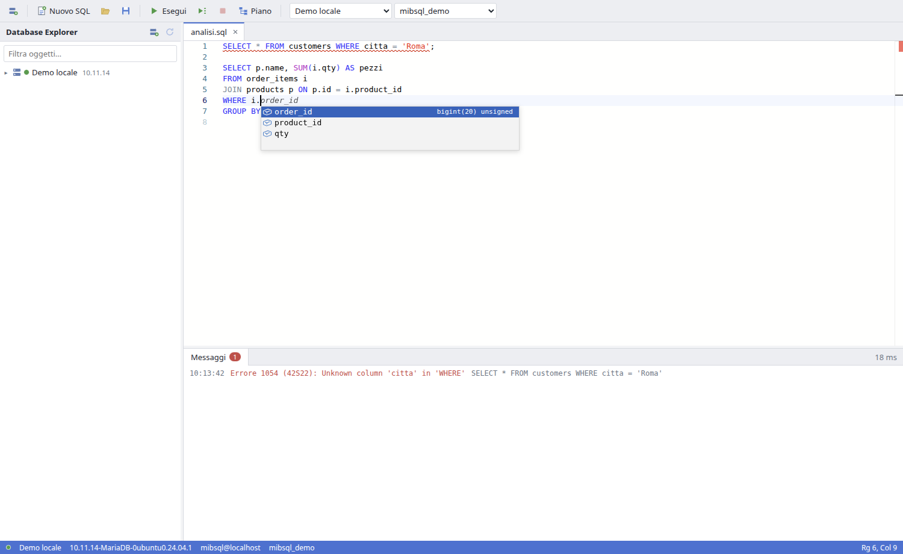

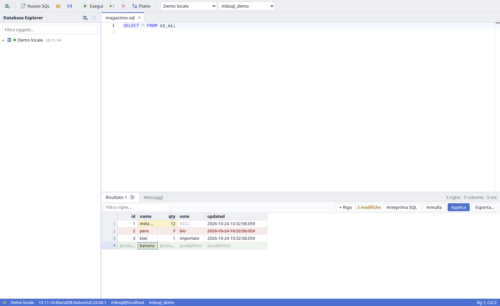

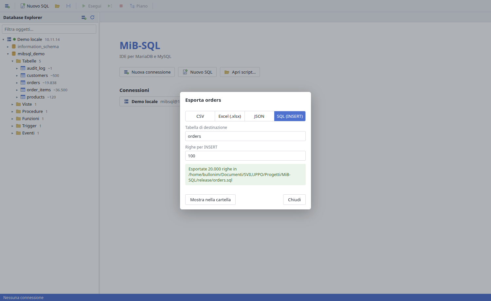

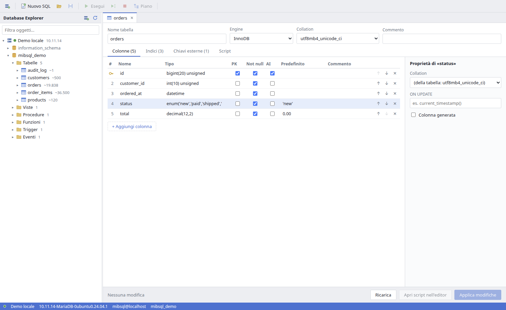

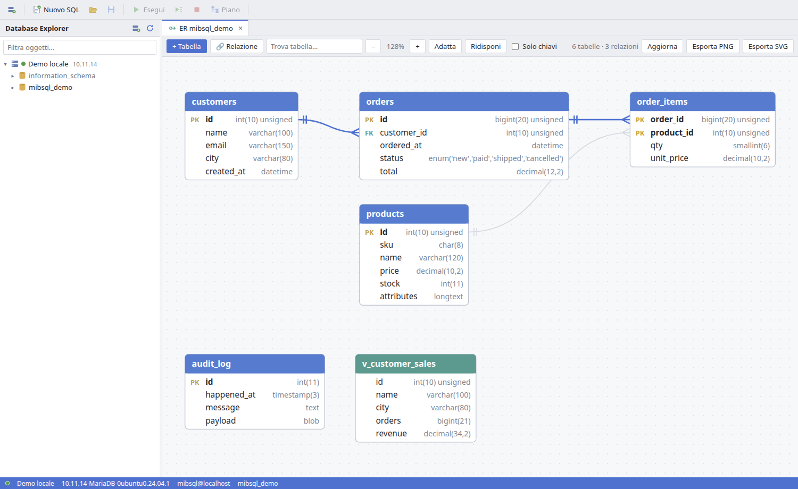

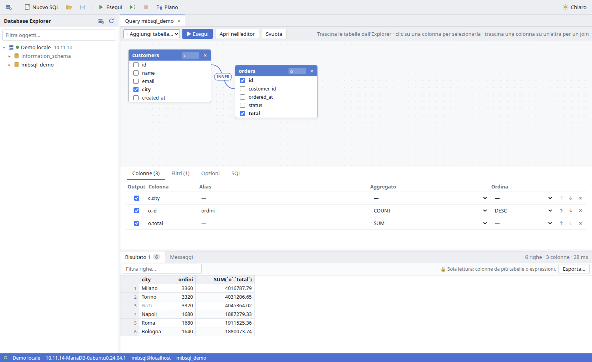

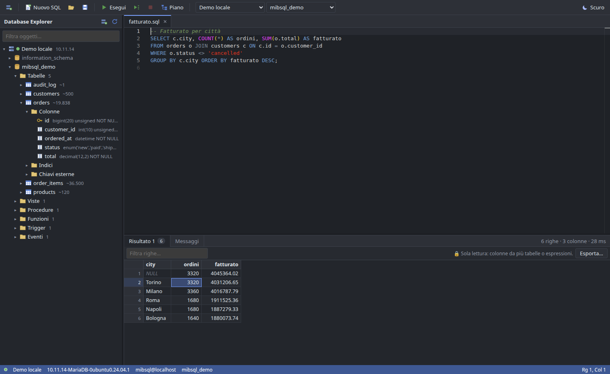

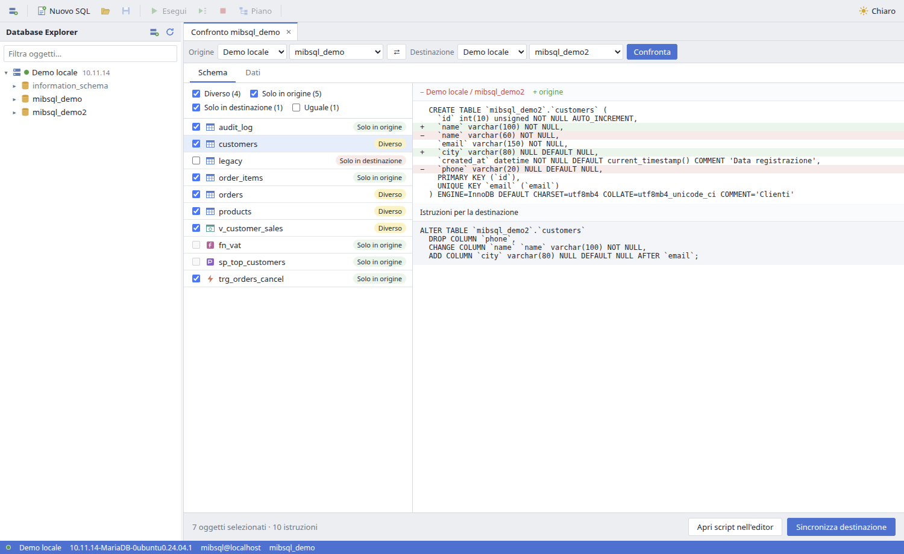

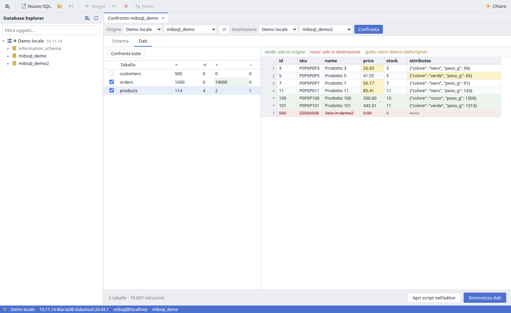

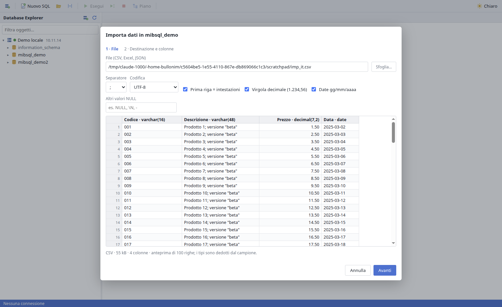

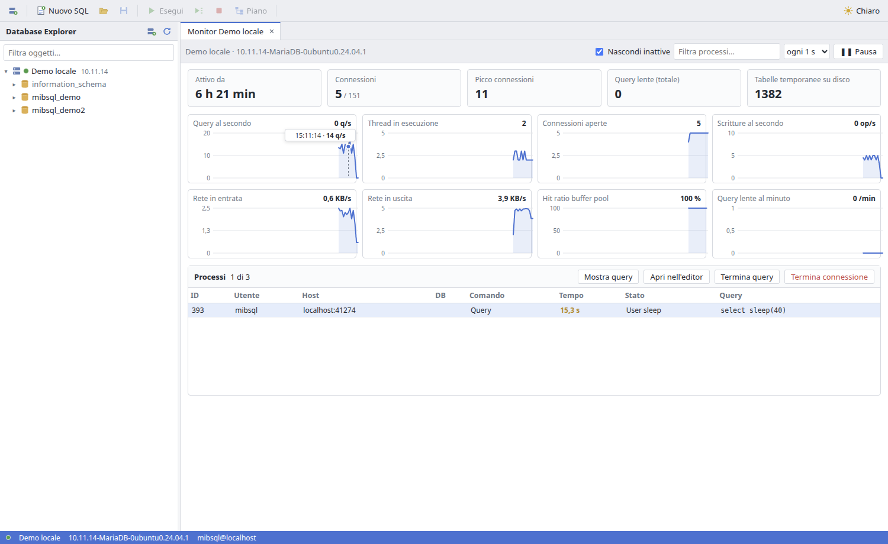

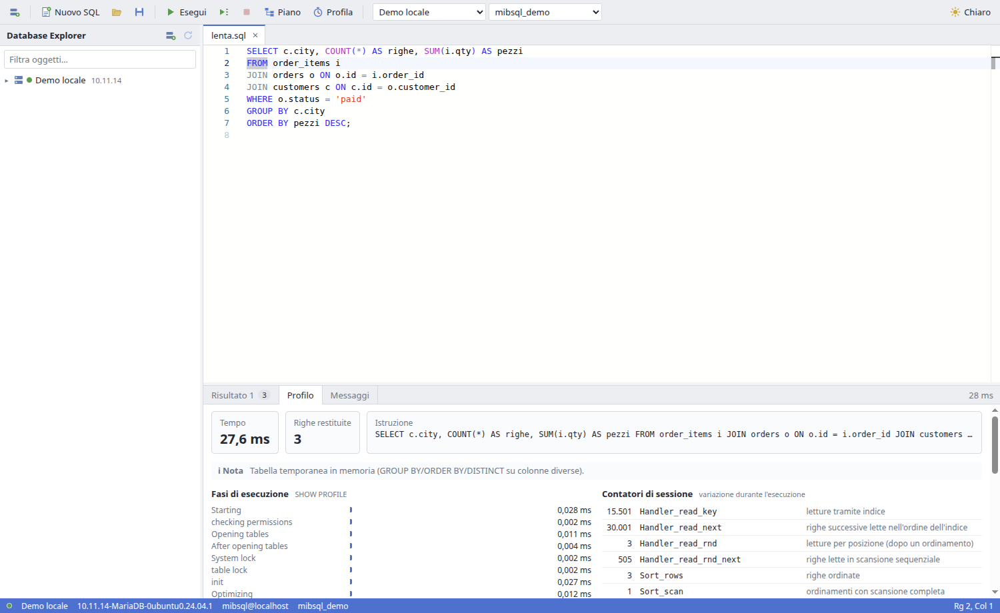

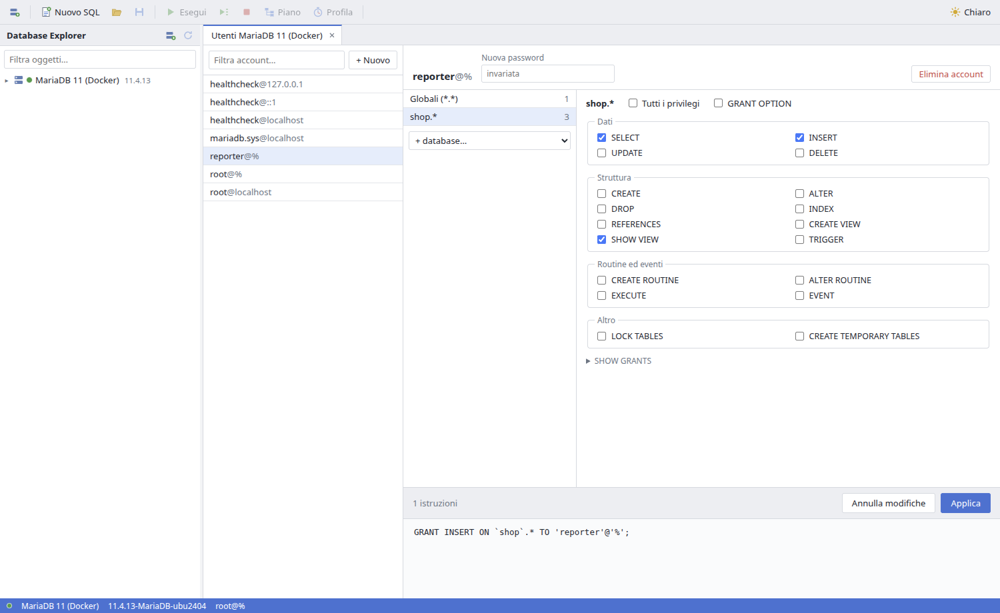

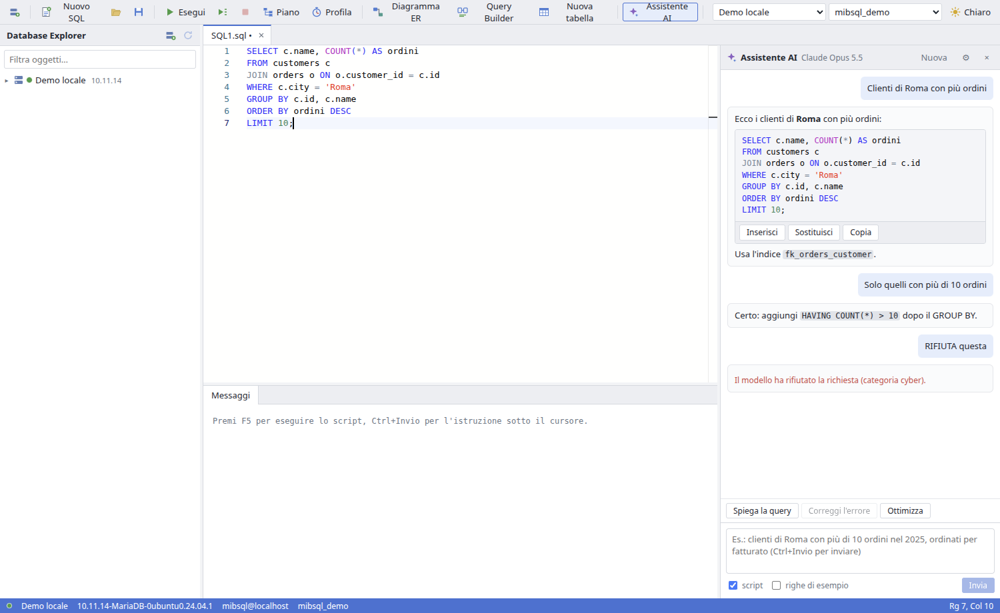

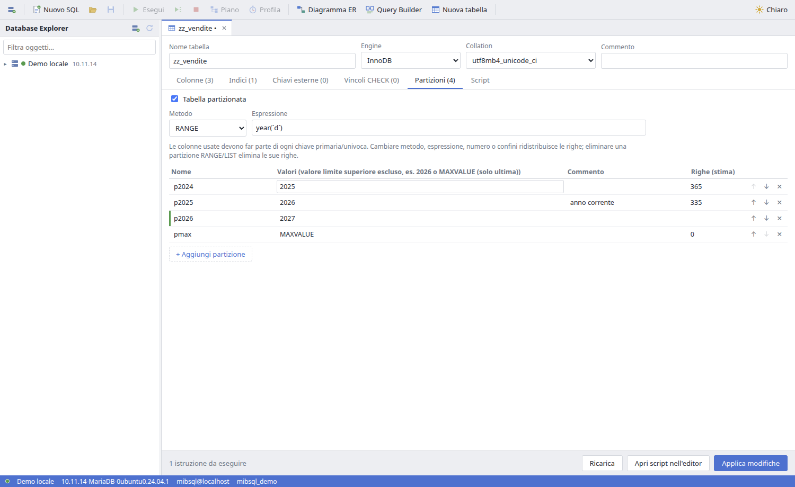

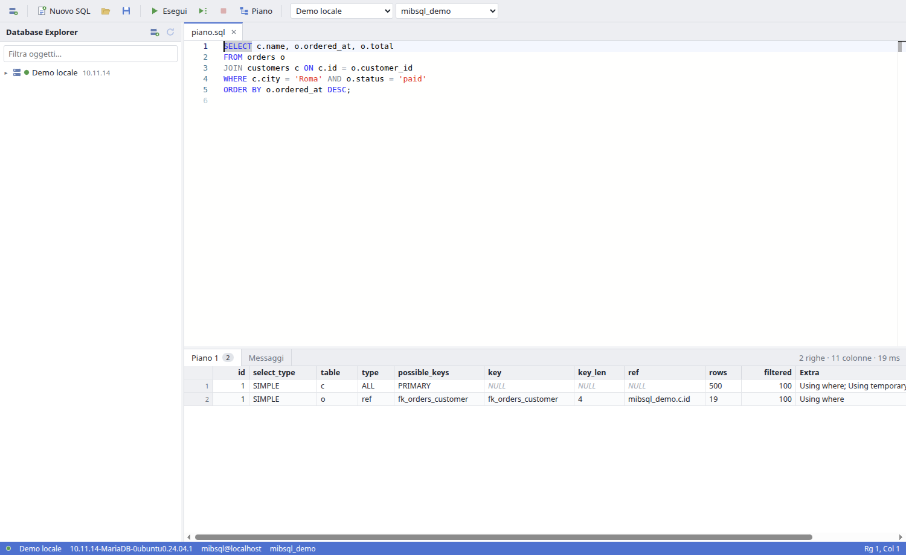

## Installazione

Dalle [release](https://github.com/mbulloni/MiB-SQL/releases):

**Debian/Ubuntu (.deb)**: installa dipendenze, voce nel menu, icona e il comando `mib-sql`:

```bash
sudo apt install ./mib-sql_x.y.z_amd64.deb
```

**AppImage** (qualsiasi distribuzione):

```bash
chmod +x MiB-SQL-*.AppImage
./MiB-SQL-*.AppImage
```

Su Ubuntu 24.04 serve `libfuse2t64` per avviare le AppImage.

## Scorciatoie

| Tasto | Azione |
|---|---|
| F5 / Ctrl+Maiusc+Invio | Esegui script o selezione |
| Ctrl+Invio | Esegui istruzione corrente |
| Ctrl+E | Piano di esecuzione (`EXPLAIN EXTENDED`) |
| Ctrl+Maiusc+P | Profila l'istruzione corrente |
| Maiusc+F5 | Interrompi |
| Ctrl+N / Ctrl+O / Ctrl+S / Ctrl+W | Nuovo, apri, salva, chiudi documento |
| Ctrl+Maiusc+N | Nuova connessione (fuori dalla griglia) |
| Ctrl+Tab | Documento successivo |
| F2 / Invio | Modifica cella (Maiusc+Invio: visualizzatore) |
| Ctrl+Maiusc+N | Imposta NULL (in griglia) |
| Canc | Elimina/ripristina righe selezionate |

## Sviluppo

```bash
npm install
npm run dev        # Vite (porta 5174) + Electron
npm test           # splitter (anche a flusso), griglia, export, designer (partizioni comprese), ER, query builder, confronto, import, assistente
npm run typecheck
npm run dist       # AppImage e .deb in release/ (npm run dist:deb solo .deb)
```

Database di prova: `scripts/demo.sql` crea `mibsql_demo` (e `mibsql_demo2`, che `scripts/demo2.sql` riempie come copia modificata per i confronti) (clienti, prodotti, 20.000 ordini, vista, funzione, procedura, trigger, evento) e l'utente `mibsql`/`mibsql` con permessi solo su quel database.

```bash
mysql -u root -p < scripts/demo.sql
```

## Roadmap

Completata: le otto fasi previste (connessioni ed editor, griglia e modifica dati, designer, ER, confronto, backup/import, profiler/monitor/utenti) più Query Builder, tema scuro, partizioni, confronto dati a memoria costante, pacchetto .deb e assistente AI.


## Limiti noti

- Le modifiche in griglia usano una connessione separata da quella del documento: non vedono le transazioni aperte nello script
- Confronto dati: oltre 200.000 differenze lo script non viene generato (il confronto sì); le colonne spaziali sono escluse; chiavi uguali solo per la collation (es. 'a'/'A' con _ci) risultano una cancellata e una inserita
- Routine e trigger di altri utenti risultano illeggibili senza privilegi sul definer: confronto e backup li segnalano ma non possono copiarli
- Le istruzioni DDL non sono transazionali: se una fallisce a metà, quelle precedenti restano applicate (designer e confronto lo segnalano e ricaricano lo stato dal server)
- Designer: sottopartizioni solo in lettura; colonne spaziali in sola lettura nella griglia
- Assistente AI: richiede una chiave API Anthropic (a pagamento); la conversazione resta solo per la sessione

## Licenza

MIT
