<p align="center"></p>

# MiB-SQL

**Italiano** · [English](README.en.md)

IDE educativo per **MariaDB e MySQL** su Linux, ispirato a [dbForge Studio](https://www.devart.com/dbforge/) (che su Linux gira solo tramite CrossOver/Wine). Electron + React + Monaco, driver nativo `mariadb`.


## Novità della v1.4

- **Cerca nel database** (pulsante con la lente, Ctrl+Maiusc+D, tasto destro su connessione o database): un testo nei nomi di tabelle, colonne, indici, viste, routine, trigger ed eventi, nel loro codice, nei commenti e nei dati
- **Log del server**: errori, query lente e log generale, con filtri; si attivano e disattivano dall'app
- **Copia database**: struttura, dati e routine in un altro database, sullo stesso server o su un'altra connessione
- **Aggiornamenti integrati**: avviso quando esce una nuova versione, novità e «Aggiorna ora» (AppImage sostituito e riavvio, .deb installato con apt)
- Generatore di dati: chiavi esterne su più colonne; Processi: installazione con un clic del plugin METADATA_LOCK_INFO su MariaDB
- Correzioni: connessioni il cui database predefinito è stato eliminato, conferme e pulsanti di alcune finestre rimasti in italiano nell'interfaccia inglese

## Novità della v1.3

- **Prestazioni** (pulsante in toolbar, pagina iniziale, tasto destro sulla connessione): consigli sulla configurazione del server con punteggio, query più pesanti, indici duplicati/inutilizzati/mancanti, analisi e ottimizzazione di una query, variabili
- **Processi**: connessioni e query in corso, transazioni aperte, chi blocca chi (lock di riga e di metadati), riepiloghi, ultimo deadlock; termina una o più connessioni
- **Dati di test**: riempie le tabelle con dati verosimili rispettando tipi, chiavi esterne e valori unici
- **Documentazione** del database in HTML o Markdown, con diagramma
- **Interfaccia in italiano e inglese** (globo in fondo alla toolbar)
- Editor oggetti su MySQL: i privilegi sulla routine vengono riassegnati da soli dopo DROP + CREATE

## Funzioni

**Connessioni**
- Profili salvati con colore d'ambiente (sviluppo/test/produzione: tinge scheda e barra di stato)
- Password nel portachiavi di sistema (Electron `safeStorage`); senza portachiavi vengono chieste a ogni sessione
- TCP, socket Unix, SSL/TLS (con verifica del certificato e CA), **tunnel SSH** (password, chiave privata, ssh-agent)
- Prova connessione; richiesta della password quando manca o è sbagliata

**Database Explorer**
- Database › Tabelle, Viste, Procedure, Funzioni, Trigger, Eventi; per tabella Colonne, Indici, Chiavi esterne
- Caricamento lazy da `information_schema`, filtro, conteggio righe stimato
- Menu contestuale: seleziona prime 1000 righe, conta righe, mostra DDL, genera CALL, copia/inserisci nome
- Trascina un oggetto nell'editor per inserirne il nome qualificato

**Editor SQL**
- Monaco con evidenziazione MySQL, una sessione dedicata per documento (USE, variabili, transazioni e tabelle temporanee restano per scheda)
- Autocompletamento sullo schema: tabelle, viste, routine, database, colonne delle tabelle referenziate e degli **alias** (`o.` → colonne di `orders`)
- Esegui script o selezione (F5), istruzione sotto il cursore (Ctrl+Invio), **piano di esecuzione** (Ctrl+E), interrompi (Maiusc+F5, `KILL QUERY`)
- Splitter compatibile con il client `mariadb`: stringhe, commenti, `DELIMITER` per procedure e trigger
- Errori sottolineati nell'editor alla riga indicata dal server; warning anche per le SELECT
- Schede ripristinate al riavvio, apri/salva `.sql`, `mib-sql script.sql` da terminale

**Formattatore, cronologia e snippet**
- **Formatta** (Ctrl+Maiusc+F, pulsante in toolbar o menu del tasto destro) sullo script o sulla selezione, annullabile: clausole a capo, una colonna per riga, AND/OR rientrati, subquery e CTE indentate, definizioni di CREATE TABLE e specifiche di ALTER TABLE una per riga; opzioni (▾): parole chiave maiuscole/minuscole/invariate, rientro 2 o 4, elenchi su una riga
- Lavora sui token: stringhe, identificatori tra backtick, commenti e `COUNT (*)`/`x'0A'` restano identici; i nomi di tabelle e alias non cambiano maiuscole (su Linux contano); i corpi di procedure, funzioni, trigger ed eventi mantengono la loro impaginazione
- **Cronologia query** (toolbar, Strumenti o pagina iniziale): ogni istruzione eseguita con data, durata, righe o errore, connessione e database; ricerca per parole, filtri per connessione ed esito, riapri o riesegui, elimina e svuota; password di CREATE/ALTER USER mascherate, registrazione disattivabile; resta sul computer (ultime 5.000)
- **Snippet SQL**: prefisso + Tab nell'editor (sel, ins, upd, del, gb, dup, cte, ct, fk, proc, func, trig…) con segnaposti da compilare; gestore per crearne e modificarne, «Salva selezione come snippet…» dal tasto destro

**Viste, routine, trigger ed eventi**
- Doppio clic (o «Modifica…») nell'Explorer apre la definizione in un editor: **Applica** (F5 o Ctrl+S) la salva sul server con CREATE OR REPLACE (MariaDB, viste MySQL) oppure DROP + CREATE con ripristino automatico della versione precedente se la nuova non compila (MySQL)
- «Nuova vista/procedura/funzione/trigger/evento…» dalle cartelle dell'Explorer (trigger anche dal tasto destro sulla tabella), rinomina con proposta di eliminare l'oggetto col vecchio nome, Ricarica, Elimina; errori sottolineati alla riga giusta
- Avvisi: DEFINER di un altro account (con «Usa il mio utente»), scheduler degli eventi spento; viste mostrate formattate
- **Esegui con parametri…** per procedure e funzioni: valori per i parametri IN/INOUT (NULL, espressioni), variabili per gli OUT, script CALL/SELECT in un nuovo documento

**Manutenzione tabelle**
- Strumenti › Manutenzione tabelle o tasto destro su database/tabella: dimensioni di dati e indici, spazio libero e frammentazione, ordinabili
- **Analizza** (anche con istogrammi su MariaDB), **Ottimizza**, **Controlla** (QUICK, EXTENDED, CHANGED…), **Ripara** (solo MyISAM/Aria/ARCHIVE/CSV), **Checksum**, una tabella alla volta con avanzamento e interruzione, NO_WRITE_TO_BINLOG facoltativo; messaggi del server spiegati

**Risultati**
- Griglia virtualizzata: le SELECT arrivano in streaming, fino a 50.000 righe in memoria con il totale esatto anche oltre; più resultset per script e per `CALL`
- Ordinamento, ridimensionamento colonne, selezione a celle, copia TSV (Ctrl+C, con intestazioni Ctrl+Maiusc+C)
- Visualizzatore valore (doppio clic/Invio) con JSON formattato; BLOB in esadecimale, modificabili e caricabili/salvabili da file; NULL distinti

**Modifica dati**
- Risultati da una sola tabella con chiave primaria (o UNIQUE NOT NULL) modificabili in griglia: F2, Invio, doppio clic o digitazione diretta; Ctrl+Maiusc+N imposta NULL
- Aggiungi righe (colonne non toccate = DEFAULT), Canc elimina/ripristina le righe selezionate
- Modifiche evidenziate, **anteprima SQL**, applicazione in un'unica transazione con controllo dei conflitti (riga cambiata da un altro utente → rollback completo)
- Dopo l'applicazione le righe vengono rilette: si vedono DEFAULT, AUTO_INCREMENT, trigger e `ON UPDATE CURRENT_TIMESTAMP`
- Il motivo della sola lettura è sempre indicato (join, espressioni, chiave primaria mancante)

**Designer tabelle**
- «Nuova tabella…» e «Modifica tabella…» dall'Explorer: documento a schede Colonne, Indici, Chiavi esterne, Script
- Colonne con tipo, PK, NOT NULL, AUTO_INCREMENT, predefinito (espressione SQL), commento, collation, ON UPDATE, CHECK di colonna (json_valid delle colonne JSON preservato), colonne generate VIRTUAL/STORED; riordino con ↑ ↓
- Vincoli CHECK di tabella; indici con colonne DESC
- Partizioni RANGE/LIST (anche COLUMNS) con confini e commenti, HASH/KEY con numero di partizioni; ALTER minimi (ADD/DROP/REORGANIZE PARTITION, ripartizionamento) con avviso quando si perdono o ridistribuiscono righe
- Indici PRIMARY/UNIQUE/INDEX/FULLTEXT/SPATIAL con colonne ordinate e prefissi; chiavi esterne verso qualsiasi database con ON DELETE/ON UPDATE (le colonne della chiave primaria riferita si compilano da sole)
- Engine, collation (anche CONVERT TO), commento e rinomina della tabella
- Script generato per differenza: `CREATE TABLE` o `ALTER TABLE` minimo (rinominare una colonna non ricrea indici e FK), posizioni FIRST/AFTER, FK modificate eliminate e ricreate; validazione prima dell'esecuzione e conferma se si eliminano colonne
- Svuota (TRUNCATE) ed elimina tabella dall'Explorer, con conferma
- Verificato su MariaDB 10.11, MariaDB 11.4 e MySQL 8.4

**Diagramma ER (editor visuale)**
- Pulsante «Diagramma ER» nella toolbar o nella pagina iniziale (sul database selezionato nell'Explorer, altrimenti viene chiesto quale), oppure tasto destro sul database: disposizione automatica a livelli, notazione a zampa di gallina, relazioni opzionali tratteggiate
- Pan, zoom con la rotella, trascinamento delle tabelle (disposizione salvata), ricerca, modalità «Solo chiavi», tabelle nascoste
- Modifica visuale: «+ Tabella», «🔗 Relazione» trascinando da una colonna alla colonna riferita (controllo dei tipi, regole ON DELETE/UPDATE, anteprima SQL), elimina relazione (selezione + Canc), modifica ed elimina tabelle
- Esporta PNG e SVG

**Query Builder visuale**
- Pulsante «Query Builder» nella toolbar o nella pagina iniziale, oppure tasto destro sul database: tabelle trascinate dall'Explorer o scelte dalla lista
- Join automatici dalle chiavi esterne o disegnati trascinando una colonna su un'altra; clic sul join per INNER/LEFT/RIGHT o per eliminarlo
- Colonne spuntate, alias, aggregati con GROUP BY automatico, ordinamento, filtri WHERE/HAVING (IN, BETWEEN, LIKE, IS NULL…), DISTINCT, LIMIT
- SQL in tempo reale, esecuzione nel documento (F5), apertura nell'editor SQL

**Confronto schema e dati**
- Tasto destro sul database › «Confronta con…»: origine e destinazione su qualsiasi connessione/database (⇄ per invertirle)
- Schema: tabelle (colonne, indici, chiavi esterne, opzioni), viste, funzioni, procedure, trigger, eventi; stato Uguale/Diverso/Solo in origine/Solo in destinazione, diff riga per riga, istruzioni per oggetto
- Script di sincronizzazione minimo (ALTER per differenza, CREATE, DROP solo se scelti), apribile nell'editor o eseguito sulla destinazione dopo conferma
- Dati: per ogni tabella con la stessa chiave primaria, a blocchi per chiave con memoria costante (2 milioni di righe in pochi secondi), righe uguali/diverse/solo in origine/solo in destinazione, dettaglio con le celle diverse evidenziate, script INSERT/UPDATE/DELETE eseguito in un'unica transazione (binari compresi)

**Backup, ripristino, import**
- «Backup…» sul database: dump SQL proprio (non serve mariadb-dump), in streaming, anche compresso .sql.gz: struttura, dati, viste (in ordine di dipendenza), funzioni, procedure, trigger (dopo i dati), eventi; UTC per i TIMESTAMP, DEFINER rimovibile, scelta delle tabelle
- «Ripristina / esegui file SQL…»: file di qualsiasi dimensione letti a flusso (anche .gz e dump di mariadb-dump/mysqldump, con DELIMITER e commenti /*!…*/), byte per byte (i BLOB non vengono alterati), avanzamento, continua dopo gli errori con elenco
- «Importa dati…»: CSV (separatore rilevato, virgolette, UTF-8/Latin-1), Excel .xlsx (scelta del foglio), JSON/NDJSON; anteprima con tipi dedotti, virgola decimale, date gg/mm/aaaa, valori NULL; nuova tabella (con id facoltativo) o esistente con mappatura delle colonne, INSERT/IGNORE/REPLACE, svuota prima; tutto in un'unica transazione

**Prestazioni e ottimizzazione**
- **Consigli**: oltre 30 controlli su contatori e variabili del server (buffer pool e letture da disco, redo log, tabelle temporanee su disco, ordinamenti, join senza indice, scansioni complete, cache di tabelle e thread, query cache, connessioni vicine al limite o rifiutate, tentativi falliti, log delle query lente, performance_schema, lock e deadlock, tabelle MyISAM, senza chiave primaria o frammentate) con punteggio, spiegazione e correzione proposta: **Applica ora** (SET GLOBAL, su MySQL 8 anche SET PERSIST) o **Copia per my.cnf**; collegamenti diretti a Processi, Indici, Query pesanti e Manutenzione
- **Query pesanti**: istruzioni raggruppate per forma da performance_schema (esecuzioni, tempo totale/medio/massimo, righe lette e restituite, segnali «senza indice», «temporanee su disco», «ordinamento su disco») oppure dal log delle query lente su tabella, attivabile con un clic senza riavvio; esempio reale (MySQL 8), apri nell'editor, azzera statistiche
- **Indici** del database scelto: duplicati e ridondanti (prefisso di un altro indice), mai usati dall'avvio (performance_schema, o userstat su MariaDB attivabile al volo) tenendo quelli che servono alle chiavi esterne e ai vincoli UNIQUE, tabelle senza chiave primaria con l'istruzione per aggiungerla (promuove un UNIQUE NOT NULL se c'è), tabelle lette senza indice, indici poco selettivi; le istruzioni scelte si aprono come script
- **Ottimizza query** (anche dal tasto destro nell'editor «Analizza e ottimizza query», o da Query pesanti): EXPLAIN senza eseguire la query, problemi riconosciuti (scansioni complete, join senza indice, filesort, tabelle temporanee, funzioni su colonne indicizzate, LIKE '%…', conversioni implicite, OR su colonne diverse, NOT IN con sottoquery, OFFSET grandi, SELECT *, ORDER BY RAND()) e **indici suggeriti** (uguaglianze e join, poi intervallo, poi ORDER BY/GROUP BY) da creare con un clic e piano ricalcolato
- **Variabili**: le più importanti per le prestazioni con spiegazione, oppure tutte, modificabili

**Processi e transazioni**
- Elenco aggiornato in automatico (o a mano), ordinabile, filtrabile, senza i thread di sistema; selezione multipla per terminare query o connessioni, «Seleziona inattive da ≥ N s»
- Righe colorate: chi blocca altri, chi è in attesa, connessioni inattive con una transazione aperta (la causa più comune dei blocchi)
- Dettaglio del thread: query formattata, transazione (età, righe bloccate e modificate, isolamento), chi aspetta e chi blocca, **piano di esecuzione della query in corso** (SHOW EXPLAIN FOR su MariaDB, EXPLAIN FOR CONNECTION su MySQL)
- **Transazioni** InnoDB aperte; **Blocchi**: per ogni thread bloccante tutti quelli che tiene fermi, anche a catena, con lock di riga (tabella, indice, modo) e di metadati (ALTER TABLE in attesa) e «Termina il bloccante»
- **Riepilogo** per utente, host, database, comando o stato; **Ultimo deadlock** letto da SHOW ENGINE INNODB STATUS, diviso per transazione con lock posseduti e attesi e vittima
- Su MariaDB senza il plugin METADATA_LOCK_INFO chi tiene un lock di metadati viene dedotto dalle transazioni aperte

**Dati di test**
- Strumenti › Generatore di dati di test, pagina iniziale o tasto destro sul database: tabelle scelte con numero di righe, ordine di inserimento calcolato dalle chiavi esterne (padri prima dei figli)
- Un generatore per colonna proposto da nome e tipo: nomi, cognomi, email coerenti con il nome, telefoni, città, indirizzi, CAP, paesi, aziende, URL, IP, UUID, parole e frasi, interi e decimali con intervallo, date e orari, sì/no, valori ENUM, modelli (`P-######`), JSON, binari, sequenze, valori fissi, espressioni SQL; dati italiani o inglesi, % di NULL
- Chiavi esterne riempite con valori esistenti della tabella padre, colonne e chiavi composte uniche senza duplicati (anche rispetto alle righe già presenti), lunghezze e tipi rispettati; AUTO_INCREMENT, DEFAULT e colonne generate lasciati al server
- Stesso seme, stessi dati; anteprima; **Genera script** (INSERT a blocchi) o **Genera e inserisci** a blocchi con avanzamento e interruzione, eventualmente svuotando prima (DELETE o TRUNCATE)

**Documentazione del database**
- HTML in pagina unica (indice laterale, riepilogo, diagramma delle relazioni, tema chiaro/scuro e stampa) o Markdown
- Tabelle con colonne (chiavi, tipo, NULL, default, extra, commenti), indici, chiavi esterne in entrambe le direzioni («Riferita da»), vincoli CHECK, trigger e CREATE TABLE facoltativo; viste, procedure, funzioni ed eventi; scelta delle tabelle e delle sezioni, anteprima, salva

**Ricerca nel database**
- Un testo in nomi di oggetti, codice (viste, procedure, funzioni, trigger, eventi), commenti e dati, su un database o su tutti; maiuscole/minuscole e parola intera
- Risultati raggruppati per tipo con il testo trovato evidenziato e la riga del codice; doppio clic apre l'oggetto nell'editor sul punto trovato (o la tabella nel designer)
- Nei dati: colonne di testo (e numeriche se il testo è un numero), valore esatto o «contiene», righe per tabella, tabelle troppo grandi saltabili, avanzamento e interruzione; «Apri query» prepara la SELECT con le stesse condizioni

**Log del server**
- **Errori**: da performance_schema.error_log (MySQL 8), dal file indicato da log_error (diretto se il server è su questo computer, altrimenti LOAD_FILE) o dal journal di systemd (MariaDB su Ubuntu); livelli Errori/Avvisi/Note/Sistema, codici e componenti, righe su più linee riunite
- **Query lente** e **Log generale**: dalla tabella (mysql.slow_log, mysql.general_log) o dal file; attiva/disattiva, uscita anche su tabella con un clic, svuota, filtro, aggiornamento ogni 5 s, doppio clic apre l'istruzione nell'editor; quando un file non è leggibile viene spiegato perché

**Copia database**
- Strumenti › Copia database, pagina iniziale o tasto destro sul database: destinazione su qualsiasi connessione, nome del nuovo database, struttura/dati/routine, scelta delle tabelle, DEFINER rimovibile; se la destinazione esiste: annulla, sostituisci o copia dentro
- Usa il dump e il ripristino dell'app tramite un file temporaneo compresso: provata MariaDB 10.11 → MariaDB 11.4, → MySQL 8.4 e sullo stesso server

**Aggiornamenti**
- All'avvio (al massimo ogni 12 ore, disattivabile) l'app legge l'ultima release su GitHub: se è più recente compare una barra sotto la toolbar e il numero di versione nella barra di stato diventa verde
- «Novità e aggiornamento…» mostra le note della release; **Aggiorna ora** scarica il file adatto: l'AppImage viene sostituito e l'app si riavvia con le schede aperte; il .deb viene installato con `pkexec apt-get` (chiede la password), altrimenti si apre l'installatore di sistema. «Salta questa versione» o «Più tardi». Controllo manuale da Strumenti › Controlla aggiornamenti o dal numero di versione

**Lingua**
- Interfaccia in italiano o inglese: globo in fondo alla toolbar; la finestra si ricarica tenendo schede e connessioni aperte. Alla prima apertura segue la lingua del sistema

**Profiler, monitor, utenti**
- **Profila** (Ctrl+Maiusc+P) l'istruzione sotto il cursore: tempo, fasi di esecuzione (SHOW PROFILE), contatori di sessione con spiegazione, piano reale (ANALYZE FORMAT=JSON su MariaDB, EXPLAIN ANALYZE su MySQL) con righe stimate/reali e tempi per tabella, consigli (join senza indice, scansioni complete, tabelle temporanee su disco, statistiche vecchie)
- **Monitor sessioni** (tasto destro sulla connessione): processi in tempo reale con durata, stato e query, termina query o connessione; indicatori e grafici di query/s, thread, connessioni, scritture, rete, hit ratio del buffer pool, query lente; aggiornamento 1-10 s, pausa
- **Utenti e privilegi**: account, nuova password, crea/elimina, privilegi per livello (globali, database, tabella, routine) a caselle, GRANT OPTION, anteprima GRANT/REVOKE minimi (password mascherate)

**Assistente AI (Claude)**
- Pulsante «Assistente AI» nella toolbar o nella pagina iniziale: pannello accanto all'editor SQL
- Domande in linguaggio naturale → SQL sul database del documento (lo schema è incluso), azioni rapide Spiega la query, Correggi l'errore (con l'errore del server), Ottimizza (con piano/profilo)
- Blocchi SQL con Inserisci, Sostituisci (annullabile) e Copia: nulla viene eseguito senza di te
- Contesto scelto da te: script dell'editor, prime righe del risultato solo se attivate; consenso esplicito al primo uso
- Chiave API nel portachiavi di sistema, oppure le credenziali di sistema (ANTHROPIC_API_KEY, `ant auth login`); modello (Claude Opus 5.5 predefinito, Sonnet 5.5, Haiku 5.5) ed effort configurabili; risposte in streaming interrompibili

**Tema chiaro e scuro**
- Interruttore in fondo alla toolbar: Chiaro, Scuro o Sistema (segue il desktop); la scelta viene ricordata
- Editor SQL, griglie, designer, diagrammi e finestre seguono il tema (gli export dei diagrammi restano chiari)

**Filtri ed export**
- Filtro testuale su tutte le colonne e filtri per valore dal menu contestuale (Filtra per / Escludi)
- Export **CSV** (separatore, intestazioni, BOM per Excel, NULL), **Excel .xlsx**, **JSON**, **SQL INSERT**
- Righe mostrate (con filtri) oppure tutte le righe rieseguendo la query in streaming; dall'Explorer «Esporta dati…» per l'intera tabella


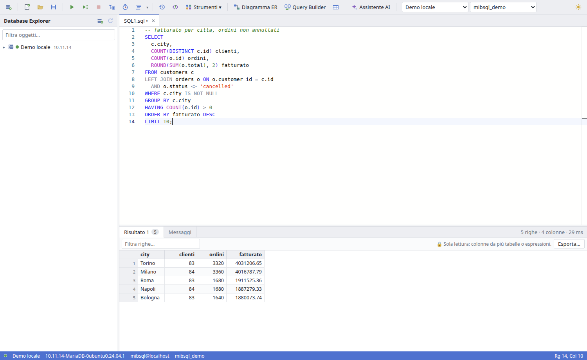

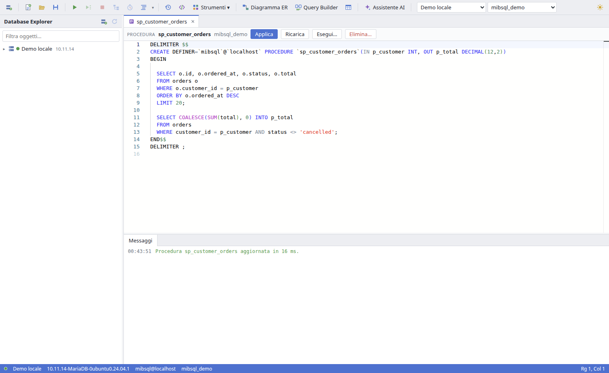

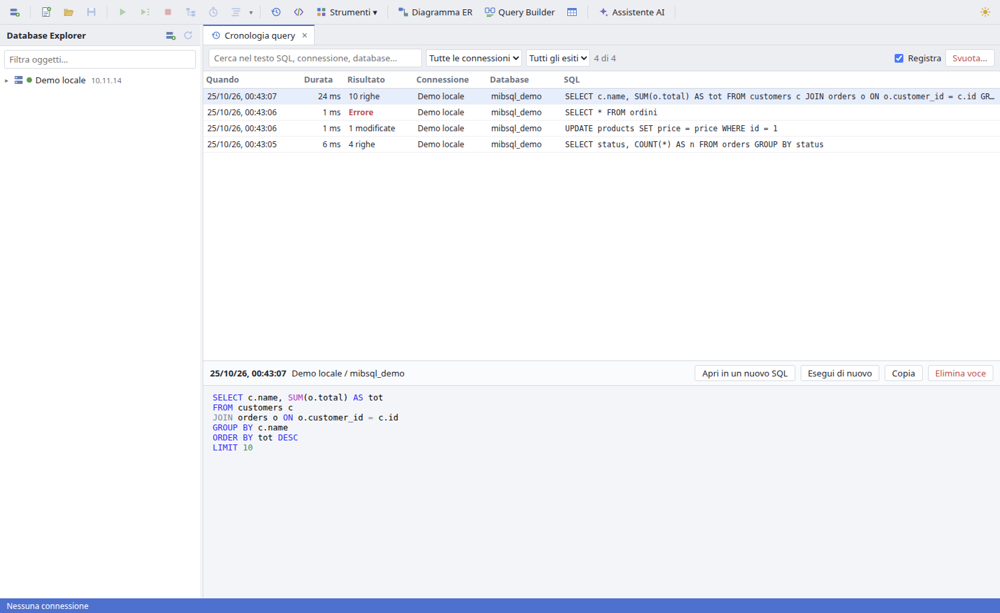

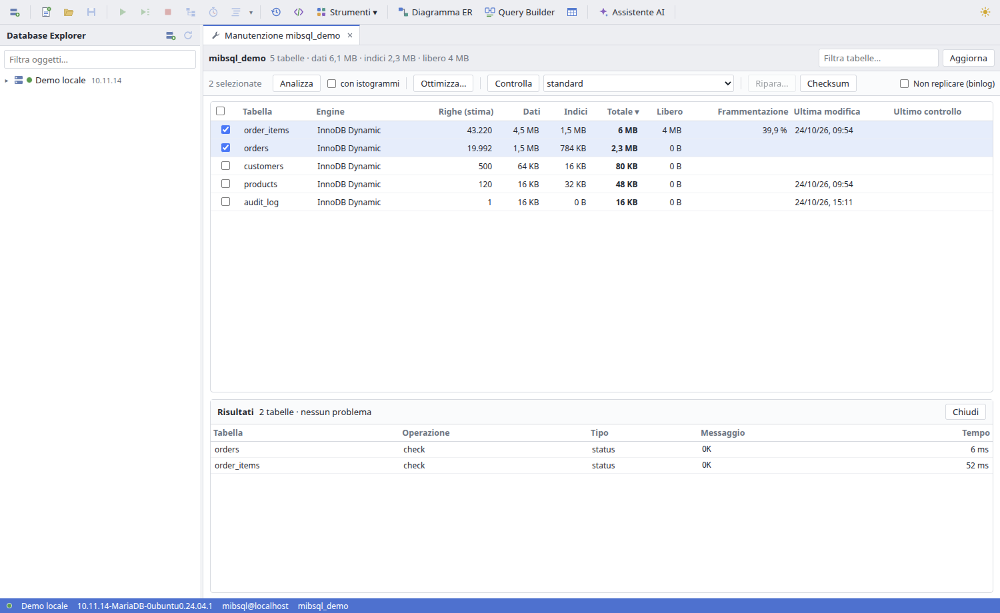

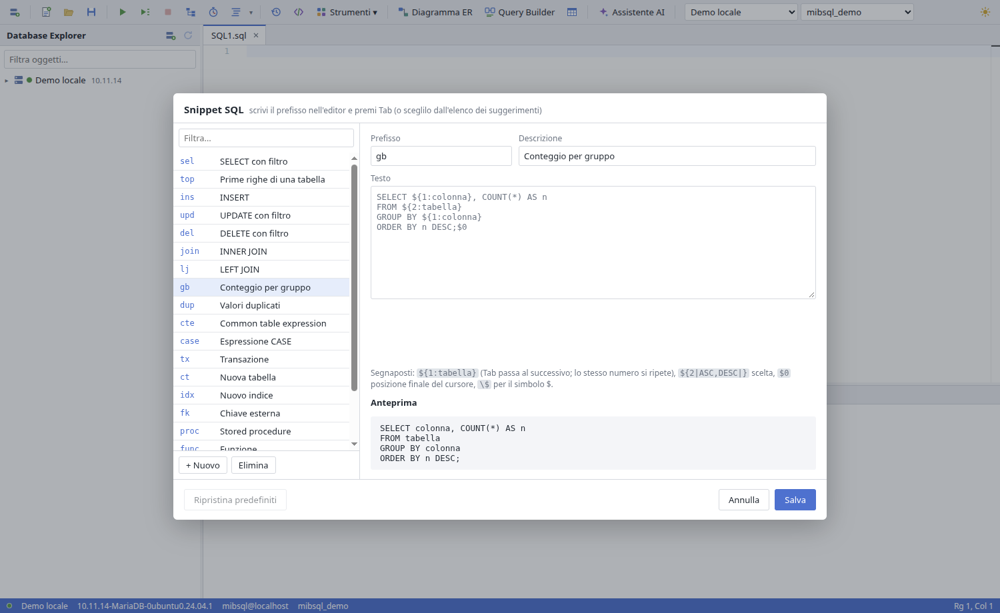


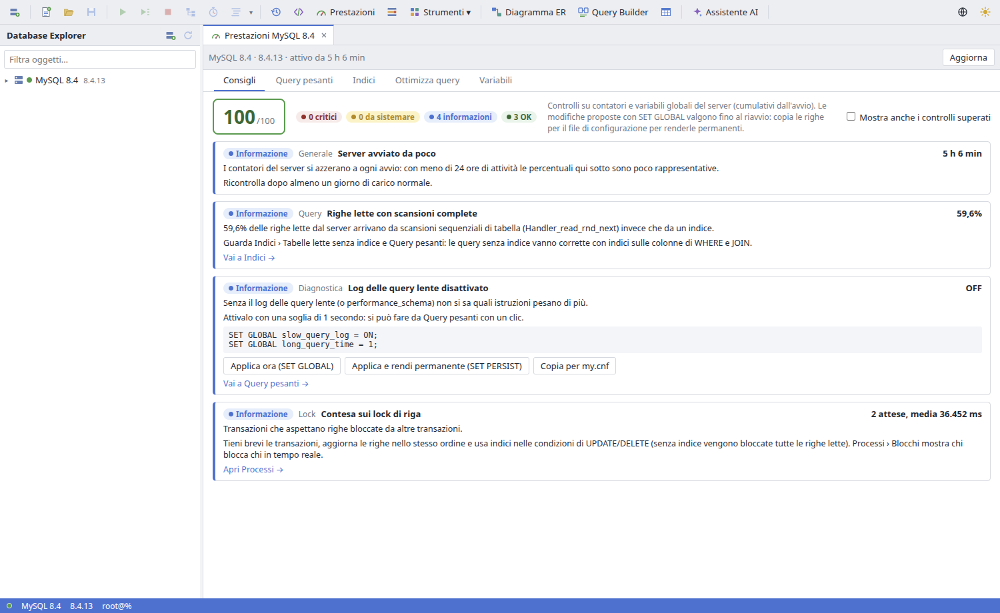

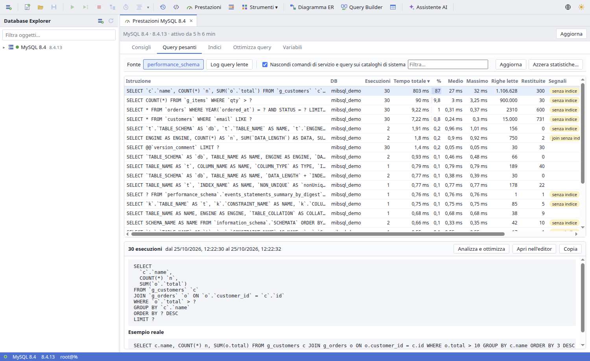

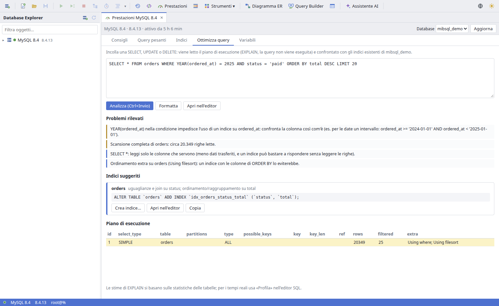

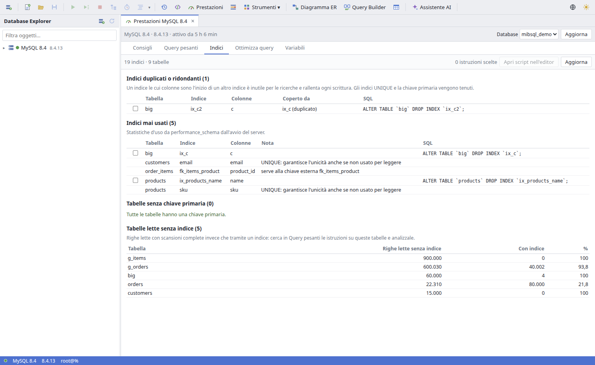

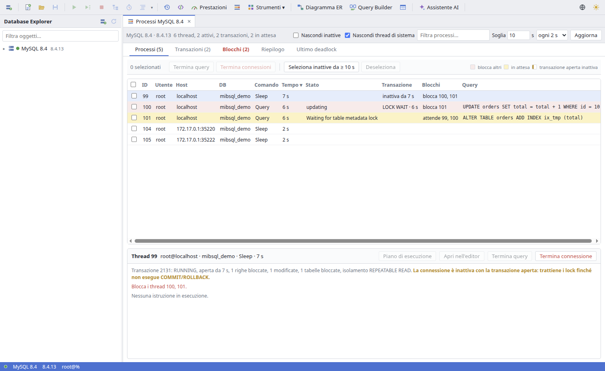

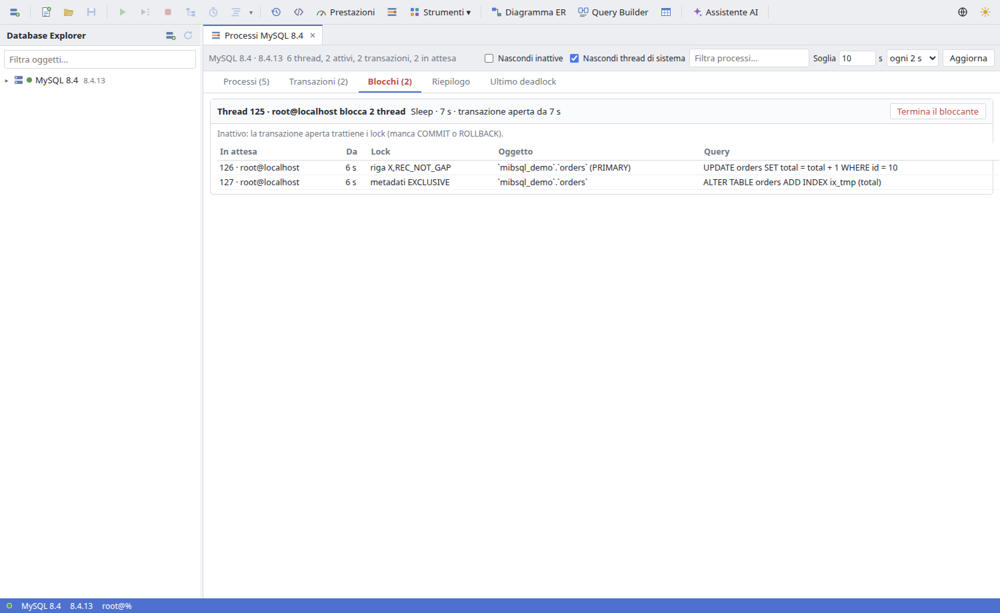

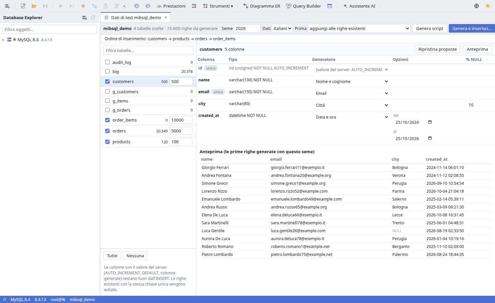

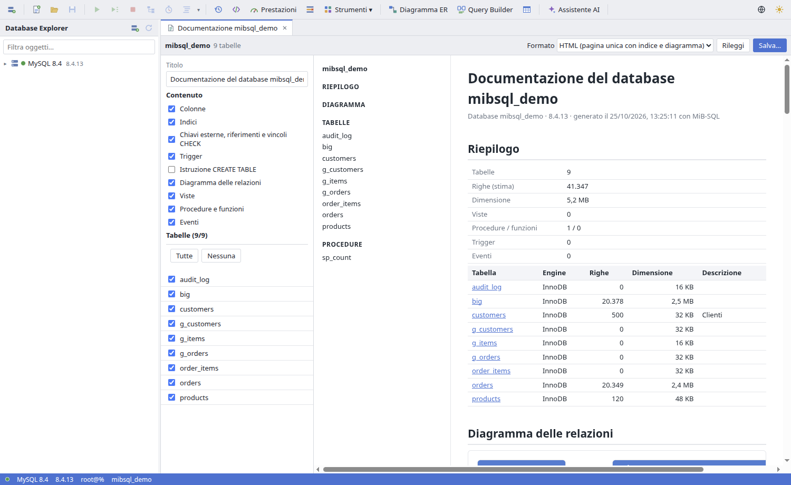


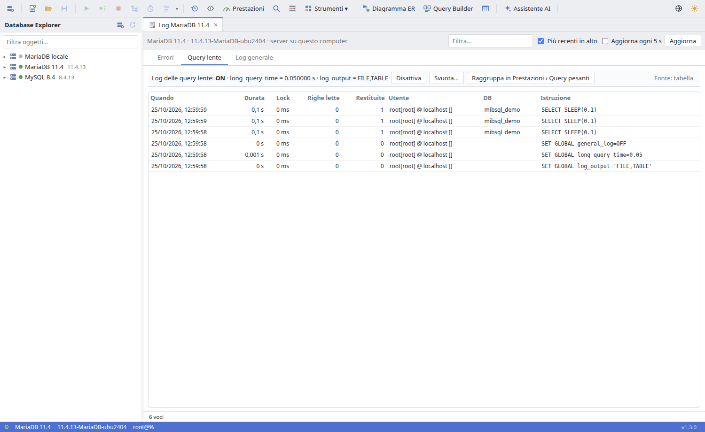

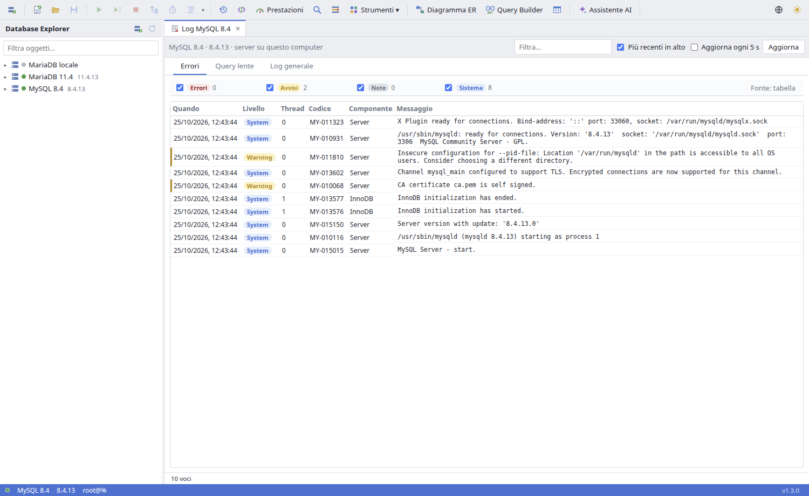

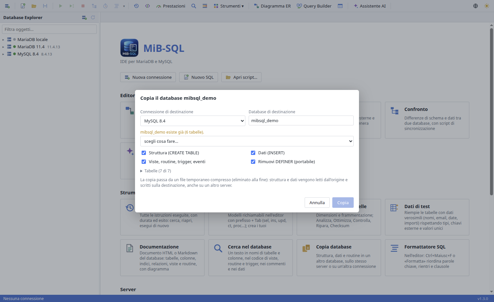


## Installazione

Dalle [release](https://github.com/mbulloni/MiB-SQL/releases):

**Debian/Ubuntu (.deb)**: installa dipendenze, voce nel menu, icona e il comando `mib-sql`:

```bash
sudo apt install ./mib-sql_x.y.z_amd64.deb
```

**AppImage** (qualsiasi distribuzione):

```bash
chmod +x MiB-SQL-*.AppImage
./MiB-SQL-*.AppImage
```

Su Ubuntu 24.04 serve `libfuse2t64` per avviare le AppImage.

Dalla v1.4.1 l'accelerazione grafica è spenta: con alcuni driver (macchine virtuali, nouveau, Intel datati) la finestra restava nera. Per riattivarla: `./MiB-SQL-*.AppImage --enable-gpu` (o `MIBSQL_ENABLE_GPU=1`). Con la v1.4.0 la finestra nera si evita con `--disable-gpu`.

## Scorciatoie

| Tasto | Azione |
|---|---|
| F5 / Ctrl+Maiusc+Invio | Esegui script o selezione |
| Ctrl+Invio | Esegui istruzione corrente |
| Ctrl+E | Piano di esecuzione (`EXPLAIN EXTENDED`) |
| Ctrl+Maiusc+P | Profila l'istruzione corrente |
| Maiusc+F5 | Interrompi |
| Ctrl+Maiusc+F | Formatta script o selezione |
| Ctrl+Invio (Ottimizza query) | Analizza la query |
| Ctrl+Maiusc+D | Cerca nel database |
| prefisso + Tab | Inserisci uno snippet |
| F5 / Ctrl+S (editor oggetti) | Applica la definizione al server |
| Ctrl+N / Ctrl+O / Ctrl+S / Ctrl+W | Nuovo, apri, salva, chiudi documento |
| Ctrl+Maiusc+N | Nuova connessione (fuori dalla griglia) |
| Ctrl+Tab | Documento successivo |
| F2 / Invio | Modifica cella (Maiusc+Invio: visualizzatore) |
| Ctrl+Maiusc+N | Imposta NULL (in griglia) |
| Canc | Elimina/ripristina righe selezionate |

## Sviluppo

```bash
npm install
npm run dev        # Vite (porta 5174) + Electron
npm test           # splitter, formattatore, griglia, export, designer, ER, query builder, confronto, import, assistente, editor oggetti,
                   # consigli, indici, analisi query, processi e deadlock, dati di test, documentazione, traduzioni
node scripts/i18n-keys.mjs   # testi da tradurre mancanti in locales/en.json
npm run typecheck
npm run dist       # AppImage e .deb in release/ (npm run dist:deb solo .deb)
```

Database di prova: `scripts/demo.sql` crea `mibsql_demo` (e `mibsql_demo2`, che `scripts/demo2.sql` riempie come copia modificata per i confronti) (clienti, prodotti, 20.000 ordini, vista, funzione, procedura, trigger, evento) e l'utente `mibsql`/`mibsql` con permessi solo su quel database.

```bash
mysql -u root -p < scripts/demo.sql
```

## Roadmap

Completata: le otto fasi previste (connessioni ed editor, griglia e modifica dati, designer, ER, confronto, backup/import, profiler/monitor/utenti) più Query Builder, tema scuro, partizioni, confronto dati a memoria costante, pacchetto .deb e assistente AI; in v1.2 formattatore, cronologia, snippet, editor di oggetti e manutenzione tabelle; in v1.3 prestazioni, processi, dati di test, documentazione e interfaccia in inglese; in v1.4 ricerca, log del server, copia database e aggiornamenti integrati.


## Limiti noti

- Le modifiche in griglia usano una connessione separata da quella del documento: non vedono le transazioni aperte nello script
- Confronto dati: oltre 200.000 differenze lo script non viene generato (il confronto sì); le colonne spaziali sono escluse; chiavi uguali solo per la collation (es. 'a'/'A' con _ci) risultano una cancellata e una inserita
- Routine e trigger di altri utenti risultano illeggibili senza privilegi sul definer: confronto e backup li segnalano ma non possono copiarli
- Le istruzioni DDL non sono transazionali: se una fallisce a metà, quelle precedenti restano applicate (designer e confronto lo segnalano e ricaricano lo stato dal server)
- Designer: sottopartizioni solo in lettura; colonne spaziali in sola lettura nella griglia
- Formattatore: i corpi di routine, trigger ed eventi ricevono solo le maiuscole delle parole chiave; le espressioni CASE e le liste tra parentesi restano su una riga
- Editor oggetti su MySQL: senza CREATE OR REPLACE la modifica è DROP + CREATE (ripristinata in caso di errore); i privilegi dati alla singola routine vengono riassegnati se l'account può leggere mysql.procs_priv, altrimenti vanno riassegnati a mano; con un DEFINER diverso dal proprio servono i privilegi SET USER/SET_USER_ID
- Prestazioni: Query pesanti e Indici › mai usati richiedono performance_schema (MySQL lo ha attivo, MariaDB no: serve il riavvio) oppure il log delle query lente / userstat; i contatori sono cumulativi dall'avvio del server; i suggerimenti di indice sono euristici, basati su EXPLAIN (stime) e sulla forma della query: vanno provati
- Processi: senza il privilegio PROCESS si vedono solo le proprie connessioni e non le transazioni; su MariaDB i lock di metadati sono esatti solo con il plugin METADATA_LOCK_INFO (installabile dalla scheda Blocchi)
- Dati di test: nello script (non inserito) le chiavi esterne usano solo i valori già presenti nel database
- Log: su server remoti senza tabelle di log né privilegio FILE i file non sono leggibili (l'app propone l'uscita su tabella); il journal di systemd è letto solo per server su questo computer
- Ricerca nei dati: legge ogni tabella per intero (LIKE '%…%'): su database molto grandi usare «salta tabelle oltre»
- Aggiornamenti: l'AppImage deve stare in una cartella scrivibile; il .deb richiede pkexec (polkit) per l'installazione automatica
- Lingua: i messaggi del server MariaDB/MySQL restano nella lingua configurata sul server (lc_messages)
- Assistente AI: richiede una chiave API Anthropic (a pagamento); la conversazione resta solo per la sessione

## Licenza

MIT
